# TrainTime

Software for a 64×32 or 32×32 RGB LED matrix on a Raspberry Pi. It has several display
modes, and you switch between them from a small web page on the Pi.

| | 64×32 | 32×32 |
|---|---|---|
| Christmas |  |  |
| Power Flow | 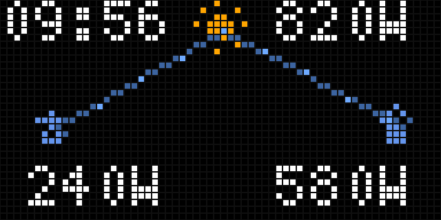 | 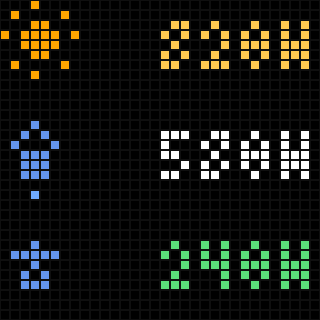 |
| Departures |  | 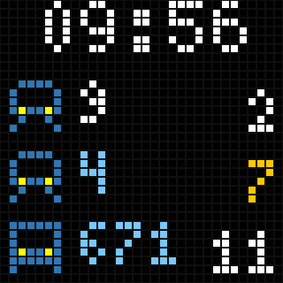 |
| Sky Clock | 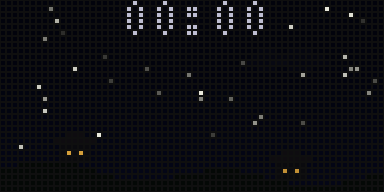 | 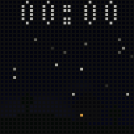 |
| Weather | 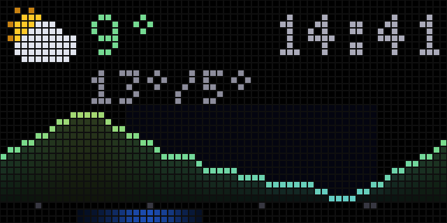 | 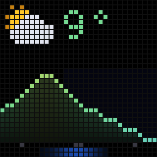 |
| Fireplace |  | 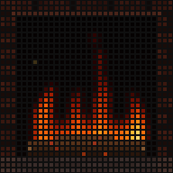 |
| Ambient Colors |  |  |
| Sky Clock day | 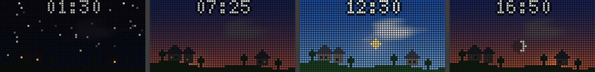 | 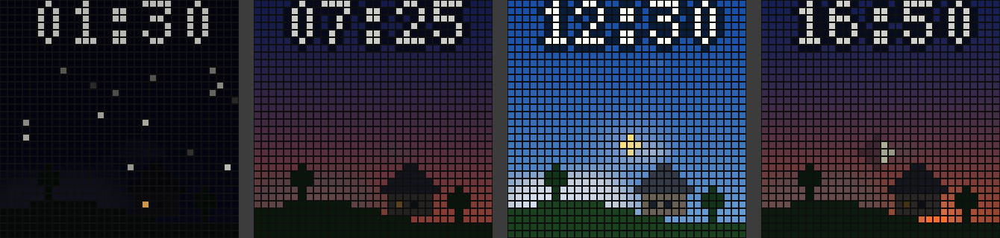 |
| Sky Clock weather | 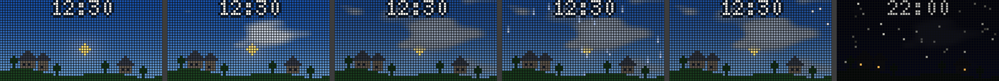 | 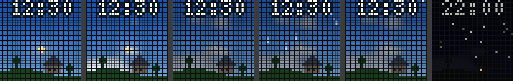 |

## Display modes

| Mode | Script | What it shows |
|---|---|---|
| Christmas Snow | `christmas_display.py` | Clock with falling snow that piles up on the ground and roofs, melts slowly and gets cleared by a passing snowplow |
| Power Flow | `power_display.py` | Live solar / grid / house power from Home Assistant, with animated arrows showing where the power flows |
| Sky Clock | `sky_display.py` | The real sky over your location with a white clock: colours follow the sun (night, dawn, day, dusk), sun and moon (with its current phase) move to their real positions, stars and the odd shooting star, houses lit at night. The current weather from [Open-Meteo](https://open-meteo.com) (free, no key): as many clouds as outside, grey skies, rain, snow, fog, lightning. Without internet it shows fair weather |
| Pictures | `picture_display.py` | Slideshow of your photos, managed on the web UI's Pictures page: upload, choose the part to show (per panel size), tick which to show, order. Slides in from the right (or crossfades); interval adjustable. Photos stay on the Pi (`display_control/pictures/`, gitignored) |
| Weather | `weather_display.py` | Current temperature and weather icon, today's high/low, and a 24-hour temperature curve (coloured cold blue to warm orange, night hours shaded) with the rain chance as a blue band. Open-Meteo, no key; location from the System page |
| Fireplace | `fire_display.py` | A crackling fire in a brick fireplace with glowing logs and sparks. Set `FIRE_BEDTIME` to let it burn down to embers at night |
| Ambient Colors | `colors_display.py` | Soft colour gradients flowing slowly across the panel; the palette (aurora, sunset, ocean, lavender, forest) changes every few minutes |
| Departures | `departures_display.py` | Next buses/trams/trains from an RMV stop (default: Darmstadt Luisenplatz towards Hbf and Lichtwiese), real-time minutes; yellow = late, red X = cancelled |

One mode runs at a time, as the systemd service `traintime.service`. It runs `main.py`, which starts
`<DISPLAY_MODE>_display.py` from `.env`.

## Web UI

Open **http://pidisplay.local:5000** (or the Pi's IP):

- **Modes**: switch what the panel shows
- **Pictures**: upload photos, crop them with a live preview of the panel, pick and order them, set the interval and transition
- **Departures**: RMV key, the stop to show (search by name), directions with short labels, a line filter and walking time
- **Wi-Fi**: add networks the Pi should use (also the setup page of the hotspot, see below)
- **System**: software version and updates, location for the Sky Clock (place search), weather on/off, brightness, restart and shut down

Settings are saved to `display_control/.env`, and the display restarts to apply them. Modes can also be switched through the API:

```bash
curl http://pidisplay.local:5000/api/status
curl -X POST http://pidisplay.local:5000/api/switch/departures   # or: christmas, power, sky, picture
```

To switch, the web UI (`web_control.py`, itself running as `display-control-web.service`) sets
`DISPLAY_MODE` in `.env` and restarts `traintime.service`. A sudoers rule (`deploy/sudoers/display-control`)
lets user `pi` run exactly the commands it needs: restart the display, the Wi-Fi helper, the updater and reboot.

## Software updates

New versions are published as [GitHub releases](https://github.com/nicolasj92/TrainTime/releases). Each
Pi's **System** page checks for a newer release (every 6 hours, or "Check again"), shows a badge in the menu
and the release notes, and installs it with one tap:

1. `pidisplay-update.service` runs `deploy/bin/pidisplay-update` as root (log: `/var/log/pidisplay-update.log`)
2. it downloads the release from GitHub and replaces the software in `~/workspace/TrainTime`, keeping
   `display_control/.env` (settings) and `display_control/pictures/`; the old version goes to `TrainTime.previous`
3. it re-runs `deploy/install.sh`, which skips what's already done (apt, LED library) and restarts the services.
   If that fails, the previous version is restored. If boot settings changed, the page offers a restart.

Only the TrainTime software is updated, not the OS (`sudo apt full-upgrade` for that).

To publish a release from a computer with the repo:

```bash
deploy/release.sh 1.1.0     # writes VERSION, commits, tags v1.1.0, pushes
```

GitHub Actions (`.github/workflows/release.yml`) then creates the release with notes from the commits.

## Wi-Fi setup hotspot

If the Pi has no Wi-Fi (or Ethernet) for `WIFI_FALLBACK_MINUTES` (default 3), for example in a new home or
after a router change, it opens a hotspot:

1. The panel shows **WiFi setup**, the hotspot name (`<hostname>-setup`, e.g. `pidisplay-setup`), its password and `10.42.0.1`
2. Join that network with your phone. The setup page should open by itself; if not, open `http://10.42.0.1`
3. Pick your network, enter its password, and tap **Connect**. The hotspot closes, and the display goes back to normal once it's online

If the password was wrong, the hotspot comes back after about a minute. While nobody is connected to it, the Pi
also retries its known networks every `WIFI_RETRY_MINUTES` (default 10), so a router that was just rebooting
gets picked up again on its own.

How it works: `wifi-fallback.service` runs `deploy/bin/wifi-fallback` (installed as
`/usr/local/sbin/pidisplay-wifi-fallback`). It uses a NetworkManager "shared" connection for the hotspot, a
dnsmasq rule (`deploy/networkmanager/pidisplay-portal.conf`) that points every DNS name at the Pi, and an
nftables rule that sends port 80 to the web UI. It writes `/run/pidisplay/hotspot.json`, which the display
loop checks to show the setup screen. New networks are saved by `deploy/bin/pidisplay-wifi` as profiles named
`wifi-<name>`. Existing profiles are never changed.

Test it without unplugging anything: `sudo systemctl stop wifi-fallback && sudo pidisplay-wifi-fallback --test 120 ; sudo systemctl start wifi-fallback`
(you'll lose SSH for about 2 minutes).

## Hardware

- Raspberry Pi 3, 4 or 5 running Raspberry Pi OS **Trixie** (Debian 13, 64-bit). Bookworm works too.
- 32×32 HUB75 panels: two chained for 64×32 (`LED_PANEL=64x32`, the default), or one for 32×32 (`LED_PANEL=32x32`)
- RGB matrix HAT/adapter, with the panels on its **second** output, and a 5 V supply big enough for the panels

About the second output: the library is set up with `parallel=2`, so the visible panel starts at row 32 of
the canvas. The code adds that offset for you (`y_offset` in `PANEL_PRESETS` in `utils.py`). If you
wire a panel to the first output instead, set `LED_PARALLEL=1` and `LED_Y_OFFSET=0` in `.env`.

**Pi 3:** works the same. The GPIO slowdown is picked by model (Pi 4/5 → 4, Pi 3 → 2). If you see
glitches or flicker, set `LED_GPIO_SLOWDOWN` in `.env`. Building the LED library during install takes a few
minutes longer.

## Install on a new Pi

1. Flash Raspberry Pi OS Trixie (64-bit) with Raspberry Pi Imager. In its settings, set the hostname,
   user `pi`, your Wi-Fi, and enable SSH with your public key.
2. Give `pi` passwordless sudo. Trixie no longer does this by default, and the web UI and remote
   maintenance need it:
   ```bash
   echo "pi ALL=(ALL) NOPASSWD: ALL" | sudo tee /etc/sudoers.d/010_pi-nopasswd && sudo chmod 440 /etc/sudoers.d/010_pi-nopasswd
   ```
3. Get the repo to `~/workspace/TrainTime`: `git clone https://github.com/nicolasj92/TrainTime.git ~/workspace/TrainTime`
   (or copy it from a computer: `rsync -a --exclude .env TrainTime/ <pi>:workspace/TrainTime/`). Later versions
   then come from the System page.
4. Install. Set `LED_PANEL` for a 32×32 panel; 64×32 is the default:
   ```bash
   LED_PANEL=32x32 ~/workspace/TrainTime/deploy/install.sh
   sudo reboot                                          # needed once, for the audio and CPU settings
   ```
5. Open `http://<hostname>.local:5000` for keys and stations (or edit `display_control/.env`).

`deploy/install.sh` is safe to re-run. It:

1. installs missing apt packages from `deploy/apt-packages.txt` (Pillow, numpy, requests, Flask, python-dotenv, build tools). Everything runs on the system `python3`, with no venv.
2. builds [rpi-rgb-led-matrix](https://github.com/hzeller/rpi-rgb-led-matrix) at a pinned commit in `~/workspace/rpi-rgb-led-matrix` and installs its Python bindings (skipped if already built at that commit)
3. copies `display_control/fonts/*.bdf` to `/usr/share/fonts/bdf`. The LED library drops root privileges to user `daemon` before fonts load, and that user can't read `/home/pi`.
4. turns off onboard audio, which conflicts with the matrix: `dtparam=audio=off` in `/boot/firmware/config.txt`, plus blacklisting `snd_bcm2835` (needed on Trixie). You then need to reboot once
5. adds `isolcpus=3` to `/boot/firmware/cmdline.txt`, so one CPU core is left to the LED refresh (less flicker)
6. creates `display_control/.env` from `.env.example`, or adds any new settings to an existing one
7. installs the sudoers rule
8. installs the Wi-Fi fallback (helper scripts, captive-portal DNS rule) and generates the hotspot password, and the updater
9. installs the systemd services (`traintime`, `display-control-web`, `wifi-fallback`, `pidisplay-update`), then enables and (re)starts them

The repo has to live at `/home/pi/workspace/TrainTime`, because the service files use that path.

## Configuration

Everything goes in `display_control/.env`, which is gitignored. The template is
[`display_control/.env.example`](display_control/.env.example):

| Variable | Used by | Meaning |
|---|---|---|
| `DISPLAY_MODE` | all | Mode to show: `christmas`, `power`, `departures`, `sky`, `picture`, `weather`, `fire`, `colors` (Modes page) |
| `LED_PANEL` | all modes | `64x32` (default) or `32x32` |
| `LED_GPIO_SLOWDOWN` | all modes | Empty = auto by Pi model. Raise it if the image glitches |
| `LED_BRIGHTNESS` | all modes | Percent (default 80). Lower it if the power supply struggles |
| `SKY_LAT` / `SKY_LON` / `SKY_PLACE` | Sky Clock, Weather | Location for sun, moon and weather (default Darmstadt); set on the System page |
| `SKY_WEATHER` | Sky Clock | `1` = live weather from open-meteo.com, `0` = always fair weather |
| `FIRE_BEDTIME` | Fireplace | `HH:MM`: burn down to embers until 6:00; empty = always burning |
| `COLORS_MINUTES` | Ambient Colors | Minutes per palette (default 3) |
| `PICTURE_SECONDS` / `PICTURE_TRANSITION` | Pictures | Seconds per picture; `slide`, `fade` or `cut` |
| `HA_URL` | Power Flow | e.g. `http://homeassistant.local:8123` |
| `HA_TOKEN` | Power Flow | Home Assistant long-lived access token |
| `HA_SOLAR_ENTITY` | Power Flow | Solar production sensor in W |
| `HA_GRID_ENTITY` | Power Flow | Grid power sensor in W (negative = feeding in) |
| `RMV_ACCESS_TOKEN` | Departures | Free key from [opendata.rmv.de](https://opendata.rmv.de) |
| `RMV_STATION_ID` | Departures | Stop to show (default `3004736`, Darmstadt Luisenplatz) |
| `RMV_DIRECTIONS` | Departures | `id:label,…` – only departures heading via these stops; empty = all |
| `RMV_WALK_MINUTES` | Departures | Hide departures you can't reach in time (default 2) |
| `RMV_LINES` | Departures | Only these lines, e.g. `4,5,671`; empty = all |
| `RMV_POLL_SECONDS` | Departures | How often to ask RMV (default 90) |
| `WIFI_FALLBACK_MINUTES` | Wi-Fi | Minutes offline before the setup hotspot opens (default 3) |
| `WIFI_RETRY_MINUTES` | Wi-Fi | Retry known networks this often while nobody uses the hotspot (default 10) |
| `WIFI_SETUP_SSID` / `WIFI_SETUP_PASSWORD` | Wi-Fi | Hotspot name and password (`install.sh` generates the password) |
| `GITHUB_REPO` | Updates | Public repository the releases come from |

The RMV settings are easiest to change on the **Departures** page of the web UI.

Power Flow reads the two sensors (`GET /api/states/<entity>`) every 5 s, only reads data, and calculates house
consumption as `grid + solar`. A token from a non-admin HA user is enough.

Departures calls RMV's `departureBoard` once per configured direction every `RMV_POLL_SECONDS`. Minutes
always use German time, whatever timezone the Pi is set to. To find stop IDs, use
`https://www.rmv.de/hapi/location.name?accessId=<key>&input=<name>&format=json`.

Animation tweaks (plow interval, snow height) are constants at the top of `christmas_display.py`.

The clock uses the system timezone: `sudo timedatectl set-timezone Europe/Berlin`.

## Preview without hardware

`simulator.py` runs the **real** mode code with sample data on any computer. It swaps in
`fake_rgbmatrix.py` for the LED library, and needs `numpy`, `Pillow` and `python-dotenv`:

```bash
cd display_control
python3 simulator.py --gif                          # every mode at every size -> previews/
python3 simulator.py --size 32x32 --mode departures
python3 simulator.py --mode sky                     # day strip + weather variants
```

## Running manually / debugging

```bash
sudo systemctl stop traintime                       # free the matrix first
cd ~/workspace/TrainTime/display_control
sudo python3 christmas_display.py                   # or power_ / departures_display.py

sudo systemctl status traintime display-control-web
sudo journalctl -u traintime -f
```

| Problem | Fix |
|---|---|
| Brightness flickers / pulses | Usually the power supply: `vcgencmd get_throttled` other than `0x0` (or "Undervoltage detected" in `dmesg`) means the voltage drops. Use a good 5 V supply (Pi 4: 3 A for the Pi alone, plus up to ~2 A per 32×32 panel at full white, ideally a separate supply for the panels) and a short, thick cable; meanwhile lower `LED_BRIGHTNESS` |
| Glitches / ghosting | Set `LED_GPIO_SLOWDOWN` higher in `.env`; make sure audio is off (`dtparam=audio=off`) and `isolcpus=3` is set, and reboot |
| Update fails | System page shows the log tail; full log in `/var/log/pidisplay-update.log` |
| Wrong time on the clock | `sudo timedatectl set-timezone <Zone>` |
| Power Flow shows 0 W | Check `HA_*` in `.env`; `curl -H "Authorization: Bearer $HA_TOKEN" $HA_URL/api/states` |
| Departures shows "No RMV key" / "RMV key bad" | Set `RMV_ACCESS_TOKEN` in `.env`, then `sudo systemctl restart traintime` |
| Text sits half off the panel | Wrong `LED_PANEL`, or the panel is on the HAT's first output (see Hardware) |
| Hotspot doesn't appear | `sudo journalctl -u wifi-fallback`; the password must be 8+ characters |
| "already running" | Another copy is using the matrix: `sudo systemctl stop traintime` |

## Repository layout

```
display_control/
  christmas_display.py   Christmas Snow mode
  power_display.py       Power Flow mode (Home Assistant)
  departures_display.py  Departures mode (RMV)
  picture_display.py     Pictures mode
  pictures.py            picture library (uploads, crops) shared by web UI and Pictures mode
  pictures/              your photos + library.json (gitignored)
  weather_display.py     Weather mode (Open-Meteo forecast)
  fire_display.py        Fireplace mode
  colors_display.py      Ambient Colors mode
  sky_display.py         Sky Clock mode (sun/moon maths ported from suncalc.js, weather from Open-Meteo)
  main.py                entry point of traintime.service: starts the mode set by DISPLAY_MODE
  utils.py               panel presets, Display (size-aware drawing), icons, shared run loop
  web_control.py         web UI on :5000: modes, pictures, departures, Wi-Fi, system/updates (+ templates/)
  simulator.py           renders previews with fake_rgbmatrix.py on a normal computer
  previews/              output of simulator.py
  fonts/                 BDF fonts (X.Org, see fonts/AUTHORS), installed to /usr/share/fonts/bdf
  .env.example           configuration template
deploy/
  install.sh             set up a fresh Pi (also re-run by updates)
  release.sh             publish a new version (tag -> GitHub release)
  apt-packages.txt       system packages
  bin/                   wifi-fallback (hotspot daemon), pidisplay-wifi (saves networks), pidisplay-update
  networkmanager/        captive-portal DNS rule for the hotspot
  systemd/               traintime, display-control-web, wifi-fallback, pidisplay-update services
  sudoers/               display-control (what the web UI may run as root)
VERSION                  installed version (set by release.sh)
```

### Adding a mode

A mode is a class with `fps`, `__init__(self, display)` and `frame(self)`. It draws one frame using
`display.width`/`height`, `display.set_pixel`, `display.text` and `display.clock`, and the file ends with
`run(MyMode)`. Name the file `<mode>_display.py`, then add `<mode>` to `DISPLAY_MODES` in `web_control.py`
and to `simulator.py`.

The earlier Django train-departure display is kept at the git tag `legacy-django`.
