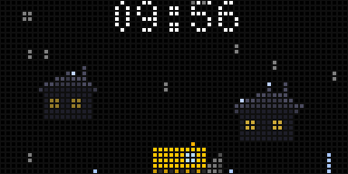
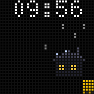
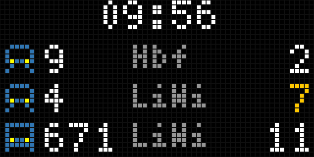

# TrainTime

Software for a 64×32 or 32×32 RGB LED matrix on a Raspberry Pi. It has several display
modes, and you switch between them from a small web page on the Pi.

| | 64×32 | 32×32 |
|---|---|---|
| Christmas |  |  |
| Power Flow |  |  |
| Departures |  |  |

## Display modes

| Mode | Script | What it shows |
|---|---|---|
| Christmas Snow | `christmas_display.py` | Clock with falling snow that piles up on the ground and roofs, melts slowly and gets cleared by a passing snowplow |
| Power Flow | `power_display.py` | Live solar / grid / house power from Home Assistant, with animated arrows showing where the power flows |
| Departures | `departures_display.py` | Next buses/trams/trains from an RMV stop (default: Darmstadt Luisenplatz towards Hbf and Lichtwiese), real-time minutes; yellow = late, red X = cancelled |

One mode runs at a time, as the systemd service `traintime.service`.

## Web UI

Open **http://pidisplay.local:5000** (or the Pi's IP):

- **Modes**: switch what the panel shows
- **Departures**: RMV key, the stop to show (search by name), directions with short labels, a line filter and walking time
- **Wi-Fi**: add networks the Pi should use (also the setup page of the hotspot, see below)

Settings are saved to `display_control/.env`, and the display restarts to apply them. Modes can also be switched through the API:

```bash
curl http://pidisplay.local:5000/api/status
curl -X POST http://pidisplay.local:5000/api/switch/departures   # or: christmas, power
```

To switch, the web UI (`web_control.py`, itself running as `display-control-web.service`) rewrites the
`ExecStart` line of `traintime.service` from `deploy/systemd/traintime.service` and restarts it. A sudoers
rule (`deploy/sudoers/display-control`) lets user `pi` run exactly those commands, plus the Wi-Fi helper.

## Wi-Fi setup hotspot

If the Pi has no Wi-Fi (or Ethernet) for `WIFI_FALLBACK_MINUTES` (default 3), for example in a new home or
after a router change, it opens a hotspot:

1. The panel shows **WiFi setup**, the hotspot name `pidisplay-setup`, its password and `10.42.0.1`
2. Join that network with your phone. The setup page should open by itself; if not, open `http://10.42.0.1`
3. Pick your network, enter its password, and tap **Connect**. The hotspot closes, and the display goes back to normal once it's online

If the password was wrong, the hotspot comes back after about a minute. While nobody is connected to it, the Pi
also retries its known networks every `WIFI_RETRY_MINUTES` (default 10), so a router that was just rebooting
gets picked up again on its own.

How it works: `wifi-fallback.service` runs `deploy/bin/wifi-fallback` (installed as
`/usr/local/sbin/pidisplay-wifi-fallback`). It uses a NetworkManager "shared" connection for the hotspot, a
dnsmasq rule (`deploy/networkmanager/pidisplay-portal.conf`) that points every DNS name at the Pi, and an
nftables rule that sends port 80 to the web UI. It writes `/run/pidisplay/hotspot.json`, which the display
loop checks to show the setup screen. New networks are saved by `deploy/bin/pidisplay-wifi` as profiles named
`wifi-<name>`. Existing profiles are never changed.

Test it without unplugging anything: `sudo systemctl stop wifi-fallback && sudo pidisplay-wifi-fallback --test 120 ; sudo systemctl start wifi-fallback`
(you'll lose SSH for about 2 minutes).

## Hardware

- Raspberry Pi 3, 4 or 5 running Raspberry Pi OS Bookworm (64-bit)
- 32×32 HUB75 panels: two chained for 64×32 (`LED_PANEL=64x32`, the default), or one for 32×32 (`LED_PANEL=32x32`)
- RGB matrix HAT/adapter, with the panels on its **second** output, and a 5 V supply big enough for the panels

About the second output: the library is set up with `parallel=2`, so the visible panel starts at row 32 of
the canvas. The code adds that offset for you (`y_offset` in `PANEL_PRESETS` in `utils.py`). If you
wire a panel to the first output instead, set `LED_PARALLEL=1` and `LED_Y_OFFSET=0` in `.env`.

**Pi 3:** works the same. The GPIO slowdown is picked by model (Pi 4/5 → 4, Pi 3 → 2). If you see
glitches or flicker, set `LED_GPIO_SLOWDOWN` in `.env`. Building the LED library during install takes a few
minutes longer.

## Install on a new Pi

As user `pi` on a fresh Raspberry Pi OS Bookworm:

```bash
sudo apt-get install -y git
git clone https://github.com/nicolasj92/TrainTime.git ~/workspace/TrainTime
~/workspace/TrainTime/deploy/install.sh
nano ~/workspace/TrainTime/display_control/.env     # see Configuration
sudo systemctl restart traintime
```

`deploy/install.sh` is safe to re-run. It:

1. installs apt packages from `deploy/apt-packages.txt` (Pillow, numpy, requests, Flask, python-dotenv, build tools). Everything runs on the system `python3`, with no venv.
2. builds [rpi-rgb-led-matrix](https://github.com/hzeller/rpi-rgb-led-matrix) at a pinned commit in `~/workspace/rpi-rgb-led-matrix` and installs its Python bindings
3. copies `display_control/fonts/*.bdf` to `/usr/share/fonts/bdf`. The LED library drops root privileges to user `daemon` before fonts load, and that user can't read `/home/pi`.
4. sets `dtparam=audio=off` in `/boot/firmware/config.txt`, because onboard audio conflicts with the matrix (you then need to reboot)
5. creates `display_control/.env` from `.env.example`, or adds any new settings to an existing one
6. installs the sudoers rule
7. installs the Wi-Fi fallback (helper scripts, captive-portal DNS rule) and generates the hotspot password
8. installs the three systemd services (`traintime`, `display-control-web`, `wifi-fallback`), then enables and starts them

The repo has to live at `/home/pi/workspace/TrainTime`, because the service files use that path.

## Configuration

Everything goes in `display_control/.env`, which is gitignored. The template is
[`display_control/.env.example`](display_control/.env.example):

| Variable | Used by | Meaning |
|---|---|---|
| `LED_PANEL` | all modes | `64x32` (default) or `32x32` |
| `LED_GPIO_SLOWDOWN` | all modes | Empty = auto by Pi model. Raise it if the image glitches |
| `HA_URL` | Power Flow | e.g. `http://homeassistant.local:8123` |
| `HA_TOKEN` | Power Flow | Home Assistant long-lived access token |
| `HA_SOLAR_ENTITY` | Power Flow | Solar production sensor in W |
| `HA_GRID_ENTITY` | Power Flow | Grid power sensor in W (negative = feeding in) |
| `RMV_ACCESS_TOKEN` | Departures | Free key from [opendata.rmv.de](https://opendata.rmv.de) |
| `RMV_STATION_ID` | Departures | Stop to show (default `3004736`, Darmstadt Luisenplatz) |
| `RMV_DIRECTIONS` | Departures | `id:label,…` – only departures heading via these stops; empty = all |
| `RMV_WALK_MINUTES` | Departures | Hide departures you can't reach in time (default 2) |
| `RMV_LINES` | Departures | Only these lines, e.g. `4,5,671`; empty = all |
| `RMV_POLL_SECONDS` | Departures | How often to ask RMV (default 90) |
| `WIFI_FALLBACK_MINUTES` | Wi-Fi | Minutes offline before the setup hotspot opens (default 3) |
| `WIFI_RETRY_MINUTES` | Wi-Fi | Retry known networks this often while nobody uses the hotspot (default 10) |
| `WIFI_SETUP_SSID` / `WIFI_SETUP_PASSWORD` | Wi-Fi | Hotspot name and password (`install.sh` generates the password) |

The RMV settings are easiest to change on the **Departures** page of the web UI.

Power Flow reads the two sensors (`GET /api/states/<entity>`) every 5 s, only reads data, and calculates house
consumption as `grid + solar`. A token from a non-admin HA user is enough.

Departures calls RMV's `departureBoard` once per configured direction every `RMV_POLL_SECONDS`. Minutes
always use German time, whatever timezone the Pi is set to. To find stop IDs, use
`https://www.rmv.de/hapi/location.name?accessId=<key>&input=<name>&format=json`.

Animation tweaks (plow interval, snow height) are constants at the top of `christmas_display.py`.

The clock uses the system timezone: `sudo timedatectl set-timezone Europe/Berlin`.

## Preview without hardware

`simulator.py` runs the **real** mode code with sample data on any computer. It swaps in
`fake_rgbmatrix.py` for the LED library, and needs `numpy`, `Pillow` and `python-dotenv`:

```bash
cd display_control
python3 simulator.py --gif                          # every mode at every size -> previews/
python3 simulator.py --size 32x32 --mode departures
```

## Running manually / debugging

```bash
sudo systemctl stop traintime                       # free the matrix first
cd ~/workspace/TrainTime/display_control
sudo python3 christmas_display.py                   # or power_ / departures_display.py

sudo systemctl status traintime display-control-web
sudo journalctl -u traintime -f
```

| Problem | Fix |
|---|---|
| Flicker / glitches | Set `LED_GPIO_SLOWDOWN` higher in `.env`; make sure audio is off (`dtparam=audio=off`) and reboot |
| Wrong time on the clock | `sudo timedatectl set-timezone <Zone>` |
| Power Flow shows 0 W | Check `HA_*` in `.env`; `curl -H "Authorization: Bearer $HA_TOKEN" $HA_URL/api/states` |
| Departures shows "No RMV key" / "RMV key bad" | Set `RMV_ACCESS_TOKEN` in `.env`, then `sudo systemctl restart traintime` |
| Text sits half off the panel | Wrong `LED_PANEL`, or the panel is on the HAT's first output (see Hardware) |
| Hotspot doesn't appear | `sudo journalctl -u wifi-fallback`; the password must be 8+ characters |
| "already running" | Another copy is using the matrix: `sudo systemctl stop traintime` |

## Repository layout

```
display_control/
  christmas_display.py   Christmas Snow mode
  power_display.py       Power Flow mode (Home Assistant)
  departures_display.py  Departures mode (RMV)
  utils.py               panel presets, Display (size-aware drawing), icons, shared run loop
  web_control.py         web UI on :5000: modes, departures settings, Wi-Fi (+ templates/)
  simulator.py           renders previews with fake_rgbmatrix.py on a normal computer
  previews/              output of simulator.py
  fonts/                 BDF fonts (X.Org, see fonts/AUTHORS), installed to /usr/share/fonts/bdf
  .env.example           configuration template
deploy/
  install.sh             set up a fresh Pi
  apt-packages.txt       system packages
  bin/                   wifi-fallback (hotspot daemon), pidisplay-wifi (saves networks)
  networkmanager/        captive-portal DNS rule for the hotspot
  systemd/               traintime, display-control-web, wifi-fallback services
  sudoers/               display-control (lets the web UI restart the display and save Wi-Fi)
```

### Adding a mode

A mode is a class with `fps`, `__init__(self, display)` and `frame(self)`. It draws one frame using
`display.width`/`height`, `display.set_pixel`, `display.text` and `display.clock`, and the file ends with
`run(MyMode)`. Then add it to `DISPLAY_MODES` in `web_control.py` and to `simulator.py`.

The earlier Django train-departure display is kept at the git tag `legacy-django` and on the
`single_display` branch.
